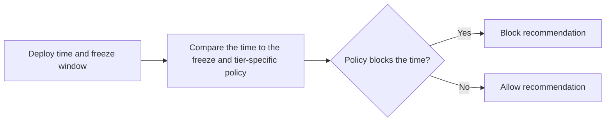

# Release Freeze Window Checker

A deployment can be operationally ready and still conflict with a business freeze or a tier-specific risky period.

[Skills and verification](docs/ENGINEERING_NOTES.md)

## What I built

I built a release calendar check that compares deployment time against the inclusive freeze interval and applies a 22:00–06:00 restriction to Tier 1. It adds an allow or block decision to each CSV row.

## How it works



[Architecture](docs/ARCHITECTURE.md) · [Decision rules and source](docs/RULES.md)

## Tools used

| Tool | Role in this repository |
| --- | --- |
| Python | [freeze_window.py](freeze_window.py) implements the CLI and decision rules. Uses `csv` to read tabular exports, `datetime` to parse deployment timestamps. |
| Make | Runs the documented example and the local `unittest` suite. |
| Python replay runner | Compares actual stdout with the checked-in baseline fixtures. |
| Ruff and Bandit | Developer lint and static security checks through `make check`. |

## Run the project

Use Python 3.10+ and Make. From the repository root:

```sh
python3 freeze_window.py sample_windows.csv
```

The sample blocks storefront at 23:10 and allows the lower-tier batch deployment in the afternoon. [Full expected output](examples/Demo%201.stdout.txt)

### Additional replay cases

- **Last sample record in isolation** · `python3 freeze_window.py examples/last-record.csv` · [Expected output](examples/Last%20sample%20record%20in%20isolation.stdout.txt)

## Verify the project

```sh
make verify
make replay
```

`make replay` checks the recorded cases and exits nonzero if the output changes.
See the [developer guide](docs/DEVELOPMENT.md) for the pinned lint and security tools.

## Operating limits

The current rule compares clock times. Supply comparable local times and handle overnight freeze intervals or timezone normalization upstream.

[Case study](docs/CASE_STUDY.md) · [Operator runbook](docs/RUNBOOK.md) · [Verification report](reports/verification.md)
