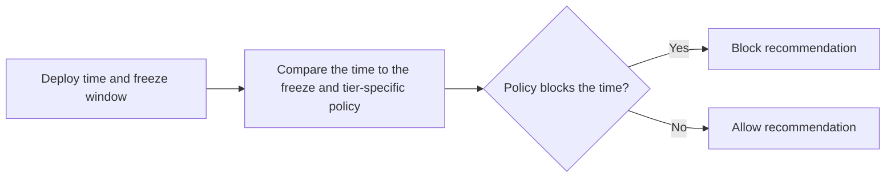

# Release Freeze Window Checker

Checks deployment windows against freeze periods and high-risk launch hours.

Focus: Consumer-scale SRE release safety.

Built as a small, runnable Python project with clear input, output, sample data, and tests.

## Run

```bash
python3 freeze_window.py sample_windows.csv
```

## Verify

```bash
python3 -m unittest discover . -v
```

## Local verification

Run `make verify` with Make and Python 3 installed. The target runs the documented sample through the project CLI. It also runs the existing Python unit tests.

## Business problem

A deployment can be operationally ready and still conflict with a business freeze or a tier-specific risky period.

## Project walkthrough



[Architecture and data flow](docs/ARCHITECTURE.md) · [Business problem, demo, and verification](docs/CASE_STUDY.md)
