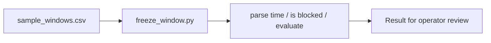

# Release Freeze Window Checker architecture

Checks deployment windows against freeze periods and high-risk launch hours.

## Operational boundaries

The documented run evaluates the bundled sample locally. Results depend on the quality and scope of the input. The demo makes no live infrastructure changes.
